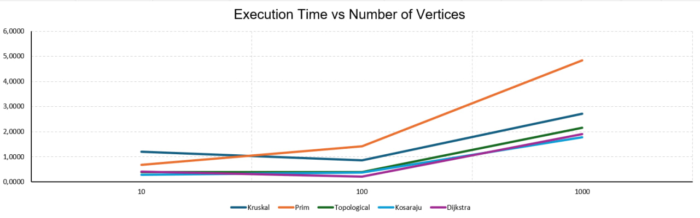
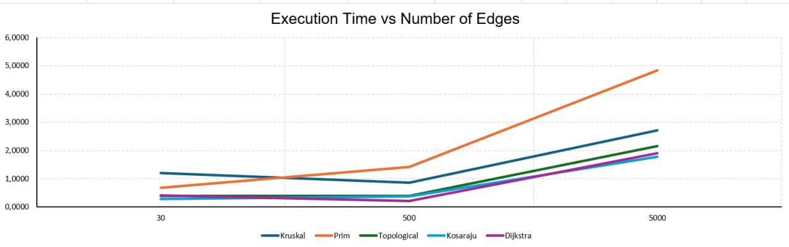

# Assignment 3

**Baikanov Daniyar**
**SE-2527**

## 1. Overview

This project is a Java application for smart city planning.

The city is represented as a graph:
- Vertices are city districts.
- Edges are roads.
- Weights are distances or costs.

The goal is to find minimum-cost networks, check connectivity, and find shortest paths.

## 2. Implementation

The project includes five algorithms:

- Kruskal - finds a minimum spanning tree using DSU.
- Prim - finds a minimum spanning tree using a priority queue.
- Topological Sort - finds the order of vertices and detects cycles.
- Kosaraju - finds strongly connected components.
- Dijkstra - finds shortest paths.

DSU uses path compression and union by rank.

## 3. Complexity Analysis

| Algorithm | Time | Space |
|---|---|---|
| DSU | O(alpha(V)) amortized per operation | O(V) |
| Kruskal | O(E log E) | O(V + E) |
| Prim | O(E log V) | O(V + E) |
| Topological Sort | O(V + E) | O(V + E) |
| Kosaraju | O(V + E) | O(V + E) |
| Dijkstra | O((V + E) log V) | O(V + E) |

V = vertices, E = edges.

## 4. Experimental Setup

Three graph sizes were used:

| Graph | Vertices | Edges |
|---|---|---|
| Small | 10 | 30 |
| Medium | 100 | 500 |
| Large | 1000 | 5000 |

Each algorithm was tested 5 times.

Execution time was measured using System.nanoTime().

Random seed: 42.

Undirected graphs were connected.
Directed graphs were generated without cycles.

## 5. Results

Average execution time (ms):

| Algorithm | Small | Medium | Large |
|---|---|---|---|
| Kruskal | 1.2087 | 0.8573 | 2.7196 |
| Prim | 0.6755 | 1.4185 | 4.8416 |
| Topological Sort | 0.3887 | 0.3967 | 2.1553 |
| Kosaraju | 0.2899 | 0.3722 | 1.7744 |
| Dijkstra | 0.4072 | 0.2025 | 1.8940 |

### Operation Counts

| Algorithm | Small | Medium | Large |
|---|---|---|---|
| Kruskal | 57 | 1087 | 16914 |
| Prim | 91 | 1501 | 15001 |
| Topological Sort | 70 | 1100 | 11000 |
| Kosaraju | 80 | 1200 | 12000 |
| Dijkstra | 30 | 500 | 5000 |
|           |       |        |       |
Full results and operation counts:
results/tables/benchmark.csv

### Execution Time vs Vertices

### Execution Time vs Edges

## 6. Comparison and Discussion

Kruskal and Prim find the same MST weight.

Kruskal was faster than Prim on the largest graph.

Execution time generally increased with graph size.

DSU improves performance using path compression and union by rank.

## 7. Testing

The program includes tests for:

- Connected graphs
- Disconnected graphs
- Graphs with cycles
- Equal edge weights
- Multiple possible MSTs
- Unreachable vertices
- Single vertex graphs
- Shortest paths

## 8. Conclusion

This project shows how graph algorithms help solve smart city problems.

Kruskal and Prim find minimum-cost networks.

Topological Sort and Kosaraju analyze directed graphs.

Dijkstra finds shortest routes.